# NetX Duo WiFi

# Introduction #
The example project demonstrates the functionalities of NetX Duo Wi-Fi Driver using Azure RTOS on Renesas RA MCUs using Renesas Silex UART Pmod. The project utilizes some functionalities of Wi-Fi Onchip Silex module which are not supported by NetX Duo. The user can either scan Wi-Fi networks or manually enter network credentials. After connecting, the EP performs DNS lookup and ping operations on the user entered URL or IP address. It also demonstrates TCP client socket communication by connecting to the user entered TCP server IP address and port number. Once connected, the user can send 'on' or 'off' commands to control the on-board LED. The LED state is displayed on the terminal, and acknowledgment messages are sent back to the server. Invalid commands do not affect the current LED state.

Please refer to the [Example Project Usage Guide](https://github.com/renesas/ra-fsp-examples/blob/master/example_projects/Example%20Project%20Usage%20Guide.pdf) for general information on example projects and [readme.txt](./readme.txt) for specifics of the operation.

## Required Resources ##
To build and run the NetX Wi-Fi example project, the following resources are needed.

### Software ###
* Renesas Flexible Software Package (FSP): Version 6.5.0
* e2 studio: Version 2026-04.2
* Terminal Console Application: Tera Term or a similar application
* LLVM Embedded Toolchain for ARM: Version 21.1.1
* Sokit software is required for creation of TCP server over specified IP and port (detailed steps mentioned below). Download Link : https://softfamous.com/sokit/
* Refer to software requirements mentioned in [Example Project Usage Guide](https://github.com/renesas/ra-fsp-examples/blob/master/example_projects/Example%20Project%20Usage%20Guide.pdf)

### Hardware ###
* Supported RA boards: EK-RA4M2, EK-RA2L1, EK-RA4M1, EK-RA6M1, EK-RA6M2, EK-RA6M3, EK-RA6M4, EK-RA6M5, EK-RA4M3, FPB-RA4E1, FPB-RA6E1, EK-RA4E2, EK-RA6E2, MCK-RA4T1, MCK-RA6T3, EK-RA8M1, EK-RA8D1, MCK-RA8T1, EK-RA2A2, FPB-RA8E1, EK-RA4L1, EK-RA8E2, EK-RA8P1, EK-RA4C1, MCK-RA8T2, EK-RA8D2, EK-RA8M2, FPB-RA4E2, FPB-RA6E2.
  * 1 x Renesas RA board.
  * 1 x Renesas Silex UART Pmod (P/N: RTK00WFMX0B01000BE).
  * 1 x Wi-Fi router Access Point (AP) with internet access.
    * Note: Please ensure the Wi-Fi Access Point credentials are available before running the project.
  * 1 x PC or laptop connected to the same Wi-Fi router AP.
    * Note:
      * Create TCP server and start listening on a free port.  
      * Port of value greater than 10,000 is recommended.   
  * 1 x USB cable for programming and debugging (USB cable type varies by board model).
  * For MCK-RA8T1, EK-RA2A2, EK-RA4L1, EK-RA4C1:
    * Some jumper wires used to connect the Renesas Silex UART Pmod to the RA board.

### Hardware Connections ###
* Connect the RA board USB debug port to the host PC using the appropriate USB cable for EP programming and debugging.

* For EK-RA4M2, EK-RA4M3, EK-RA6M3, EK-RA6M4, EK-RA6M5:
  * Connect Renesas Silex UART Pmod ----> PMOD1 (J26)
  * Please carefully align pin 1 on the Renesas Silex UART Pmod with pin 1 on the PMOD1.

* For EK-RA6M1, EK-RA6M2, EK-RA4M1:
  * Connect Renesas Silex UART Pmod ----> PMODA (J5)
  * Please carefully align pin 1 on the Renesas Silex UART Pmod with pin 1 on the PMODA.

* For EK-RA2L1, FPB-RA4E1, FPB-RA6E1, EK-RA4E2, EK-RA6E2, MCK-RA4T1, MCK-RA6T3, EK-RA8M1, EK-RA8D1, FPB-RA8E1, EK-RA8P1, EK-RA8D2, EK-RA8M2:
	* For EK-RA8M2, the user must place jumper J6 on pins 2-3, J8 on pins 1-2, J9 on pins 2-3, and J29 on pins 1-2, 3-4, 5-6, 7-8 to use the on-board debug functionality.
  * Connect Renesas Silex UART Pmod ----> PMOD2 (J25)
  * Please carefully align pin 1 on the Renesas Silex UART Pmod with pin 1 on the PMOD2.

* For MCK-RA8T1:
  * Connect
    * Renesas Silex UART Pmod (CN1:2) ----> P112
    * Renesas Silex UART Pmod (CN1:3) ----> P113
    * Renesas Silex UART Pmod (CN1:5) ----> GND
    * Renesas Silex UART Pmod (CN1:6) ----> VCC
    * Renesas Silex UART Pmod (CN1:8) ----> P114

* For EK-RA2A2:
  * Connect
    * Renesas Silex UART Pmod (CN1:2) ----> P501 (J1:1)
    * Renesas Silex UART Pmod (CN1:3) ----> P500 (J4:19)
    * Renesas Silex UART Pmod (CN1:5) ----> GND
    * Renesas Silex UART Pmod (CN1:6) ----> VCC
    * Renesas Silex UART Pmod (CN1:8) ----> P203 (J3:9)

* For EK-RA4L1:
	* Connect
		* Renesas Silex UART Pmod (CN1:2) ----> P109 (J3:19)
		* Renesas Silex UART Pmod (CN1:3) ----> P110 (J3:20)
		* Renesas Silex UART Pmod (CN1:5) ----> GND  (J3:25)
		* Renesas Silex UART Pmod (CN1:6) ----> VCC  (J3:1)
		* Renesas Silex UART Pmod (CN1:8) ----> P306 (J4:11)

* For EK-RA8E2:
  * The user must turn ON SW4-4 to use PMOD2 for UART.
  * Connect Renesas Silex UART Pmod (CN1:1) ----> PMOD2 (J25:1)
  * Please carefully align pin 1 on the Renesas Silex UART Pmod with pin 1 on the PMOD2.

* For EK-RA4C1:
  * The user must place jumper J6 on pins 2-3, J8 on pins 1-2, J9 on pins 2-3, and turn OFF SW4-4 to use the on-board debug functionality.  
  * The user must close E52 to use P305 for RST pin of PMOD2.
  * Connect
    * Renesas Silex UART Pmod (CN1:2) ----> P115 (J2:35)
    * Renesas Silex UART Pmod (CN1:3) ----> P608 (J2:37)
    * Renesas Silex UART Pmod (CN1:5) ----> GND  (J2:1)
    * Renesas Silex UART Pmod (CN1:6) ----> VCC  (J1:1)
    * Renesas Silex UART Pmod (CN1:8) ----> P305 (J2:38)

* For MCK-RA8T2:
  * Connect Renesas Silex UART Pmod (CN1:1) ----> Pmod 3A/6A (CN6:1)
  * Please carefully align pin 1 on the Renesas Silex UART Pmod with pin 1 on the Pmod 3A/6A.

* For FPB-RA4E2:
  * The user must close E6 and open E5 to use PMOD1 for UART.
  * Connect Renesas Silex UART Pmod ----> PMOD1
  * Please carefully align pin 1 on the Renesas Silex UART Pmod with pin 1 on the PMOD1.

* For FPB-RA6E2:
  * The user must close E6 and open E5 to use PMOD1 for UART.
  * Connect Renesas Silex UART Pmod ----> PMOD1
  * Please carefully align pin 1 on the Renesas Silex UART Pmod with pin 1 on the PMOD1.

## Related Collateral References ##
The following documents can be referred to for enhancing your understanding of the operation of this example project:
* [FSP User Manual on GitHub](https://renesas.github.io/fsp/)
* [FSP Known Issues](https://github.com/renesas/fsp/issues)

# Project Notes #

## System Level Block Diagram ##

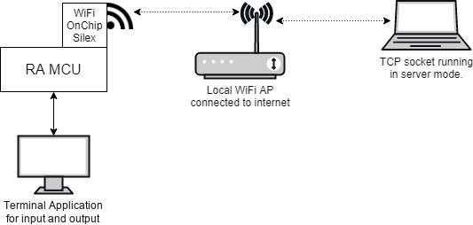

## FSP Modules Used ##
List all the various modules that are used in this example project. Refer to the FSP User Manual for further details on each module listed below.

| Module Name | Usage | Searchable Keyword (using New Stack > Search) |
|-------------|-----------------------------------------------|-----------------------------------------------|
| Azure RTOS NetX Duo IP Instance | This module provides network drivers for Azure RTOS NetX Duo. | Azure RTOS NetX Duo Network Drivers |
| NetX Duo Wi-Fi Driver | For IP communication the NetX IP instance needs to be used. | NetX Duo IP |
| NetX Duo packet pool | Packet Pool Module is used to send and receive the created data packets over TCP network. | NetX Duo Packet Pool | 
| Wi-Fi Onchip Silex Driver | For Wi-Fi SSID connect, ping to IP/URL Wi-Fi Onchip Silex Driver is used. | Wi-Fi Onchip Silex Driver |

## Module Configuration Notes ##
This section describes FSP Configurator properties that are important or different from those selected by default. 

|   Module Property Path and Identifier   |   Default Value   |   Used Value   |   Reason   |
| :-------------------------------------: | :---------------: | :------------: | :--------: |
| configuration.xml > BSP > Properties > Settings > Property > RA Common > Main stack size (bytes) | 0x400 | 0x400 | Main Program thread stack is configured to store the local variables of different functions in the code. |
| configuration.xml > BSP > Properties > Settings > Property > RA Common > Heap size (bytes) | 0 | 0x400 | Higher Heap size is required for standard library functions to be used as per FSP recommendation. |
| configuration.xml > Stacks > Threads > Terminal Thread > Properties > Settings > Property > Thread > Priority | 1 | 5 | Terminal thread priority is lowered to allow the IP threads to process incoming packets at the fastest rate possible. |
| configuration.xml > Stacks > Threads > Azure Wi-Fi Thread > Properties > Settings > Property > Thread > Priority | 1 | 4 | Priority of the Application threads generally given lower priority compared to system services threads. |
| configuration.xml > Stacks > Threads > Azure Wi-Fi Thread > Properties > Settings > Property > Thread > Stack size (bytes) | 1024 | 4096 | Updated to handle thread its worst-case function call nesting and local variable usage. |
| configuration.xml > Stacks > Threads > Azure Wi-Fi Thread > Azure Wi-Fi Thread Stacks > g_ip0 Azure RTOS NetX Duo IP Instance > Properties > Settings > Property > Module g_ip0 Azure RTOS NetX Duo IP Instance > Default Gateway Address | 0.0.0.0 | 192.168.0.1 | Valid Gateway address for IP routing. |
| configuration.xml > Stacks > Threads > Azure Wi-Fi Thread > Azure Wi-Fi Thread Stacks > g_ip0 Azure RTOS NetX Duo IP Instance > Properties > Settings > Property > Module g_ip0 Azure RTOS NetX Duo IP Instance > Subnet Mask | 255.255.255.0 | 0.0.0.0 | Subnet mask for IP routing. |

## API Usage ##

The table below lists the Azure RTOS NetX Duo Network Drivers API used at the application layer by this example project.

| API Name    | Usage                                                                          |
|-------------|--------------------------------------------------------------------------------|
| rm_wifi_onchip_silex_open | This API is used to initialize the Wi-Fi module driver. |
| rm_wifi_onchip_silex_scan | This API is used to scan all Wi-Fi Access Points. |
| rm_wifi_onchip_silex_connect | This API is used to connect with specified Wi-Fi Access Point. |
| rm_wifi_onchip_silex_dns_query | This API is used to perform a DNS lookup. |	
| rm_wifi_onchip_silex_ip_addr_get | This API is used to fetch the IP address assigned to MCU. |	
| rm_wifi_onchip_silex_ping | This API is used to perform the Ping operation. |	
| nx_system_initialize | This API is used to initialize NetX System. |	
| nx_packet_pool_create | This service is used to create a packet pool of the specified packet size in the memory area. | 	
| nx_ip_create | This API is used to create an IP Instance. |
| nx_tcp_enable | This API is used to enable the Transmission Control Protocol (TCP) component of NetX. |	
| nx_tcp_socket_create | This API is used to create a TCP client or server socket for the specified IP instance. |	
| nx_tcp_client_socket_bind | This API is used to bind the previously created TCP client socket to the specified TCP port. |	
| nx_tcp_client_socket_connect | This API is used to connect the previously-created and bound TCP client socket to the specified server's port. |		
| nx_packet_allocate | This API is used to allocate a packet from the specified pool. |
| nx_tcp_socket_send | This service is used to send TCP data through a previously connected TCP socket. |	
| nx_tcp_socket_receive | This service is used to receive TCP data from the specified socket. |

## Verifying Operation ##
1. Set up the hardware connection properly mentioned in [Hardware Connections](#hardware-connections).
2. Import, generate, build, and download project to the RA board.
3. Open a serial terminal application (e.g., Tera Term) to view output, configure the settings as follows:

    * To make sure the received data shows properly, the user needs to set:
      * [Setup] -> [Terminal...] -> [New-line] -> Select [Receive: CR] & [Transmit: CR].
    * To echo back characters typed in Tera Term, the user needs to enable it through:
      * [Setup] -> [Terminal...] -> Check [Local echo].
    * The configuration parameters of the serial port on the serial terminal application:
      * Port: The port is provided by the J-Link On-Board.
      * Speed: 115200
      * Data: 8 bit
      * Parity: none
      * Stop bits: 1 bit
      * Flow control: none

## The images below showcase the output ##
**The EP information:** 

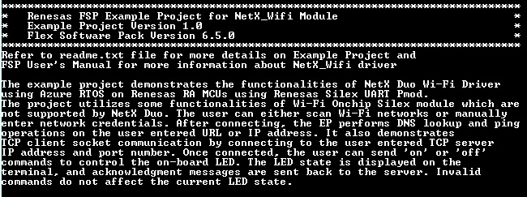

**Scan for Wi-Fi Access Points:**
* The user presses '1' to scan for Wi-Fi Access Points.

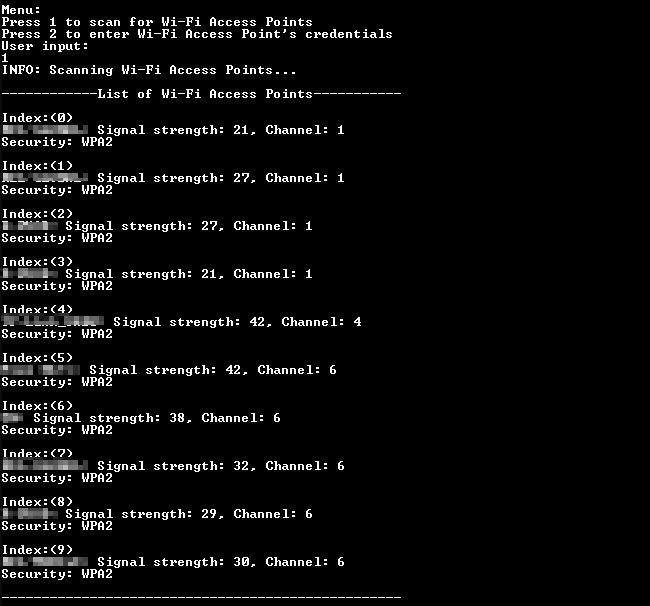

* Enter the Wi-Fi index and password for Wi-Fi connection.

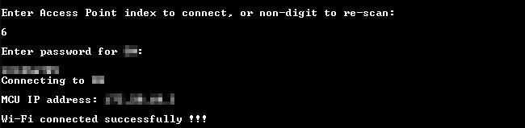

**Enter Wi-Fi AP credentials manually:**

* The user can press '2' to enter Wi-Fi AP credentials manually. Then the user enters SSID and password for Wi-Fi connection. 

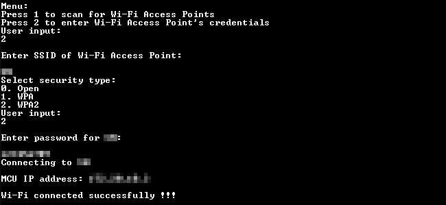

**Ping operation:** 

* The user enter IP address or URL to ping:

**Connection to TCP server:** 

* Validation of TCP server entered by the user and prompt for the user to enter valid port number:

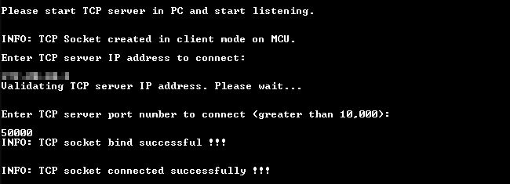

* Send message to server on connection and wait for server message:      

* The message from TCP server as "on" or "off" is sent and is displayed on terminal upon successful reception of valid message:  
(Here either "on" or "off" is considered as a valid message from TCP server as these perform same action on the user LED. Refer below images for Sokit tool images.)

## Steps for TCP server creation and connection ##

* Download and run Sokit application (Download link attached in **[Software](#Software)** Requirements section of this file). The application interface looks like below image.

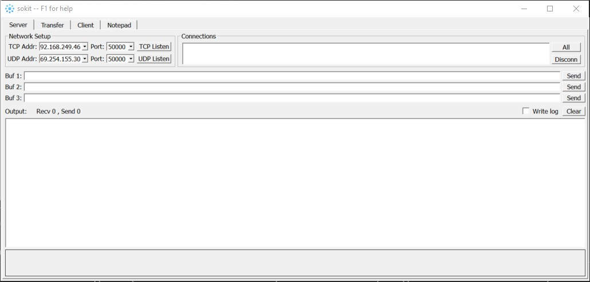

* On Windows, to find the **TCP server IP address**, open **Command Prompt** and enter **ipconfig**, the **IPv4 Address** shown is the **TCP server IP address**. **And ensure that the TCP server and TCP client are on the same Wi-Fi network.**

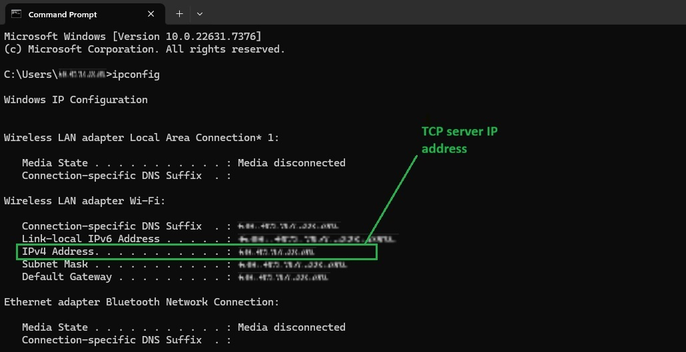

* Once started sokit, in the **Server** tab configure the **Network Setup**. In the **TCP Addr** field, enter the PC's IPv4 address. And in **Port** field, enter the port number (Create TCP server and start listening on a free port and value greater than 10,000 is recommended.). After entering the details click on **TCP Listen** button in application as shown in below image.   

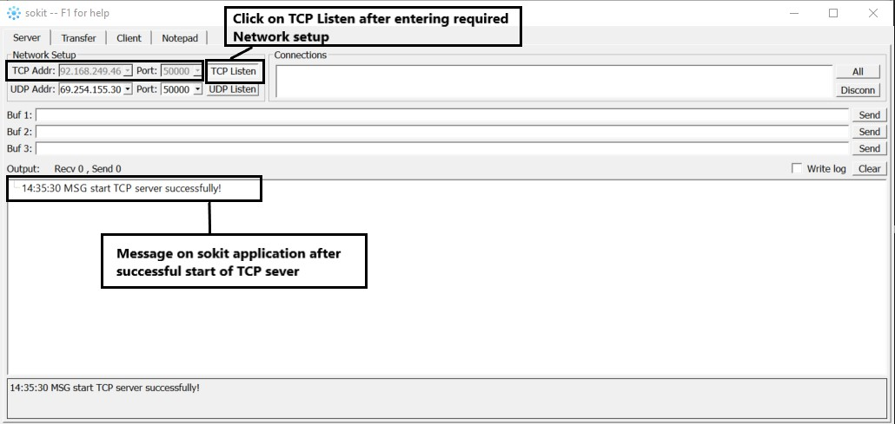

* After successful connection to the TCP server, sokit application shows IP address and port number of the client under **Connections** section in sokit application with "Hello" message from client, as shown in image below.

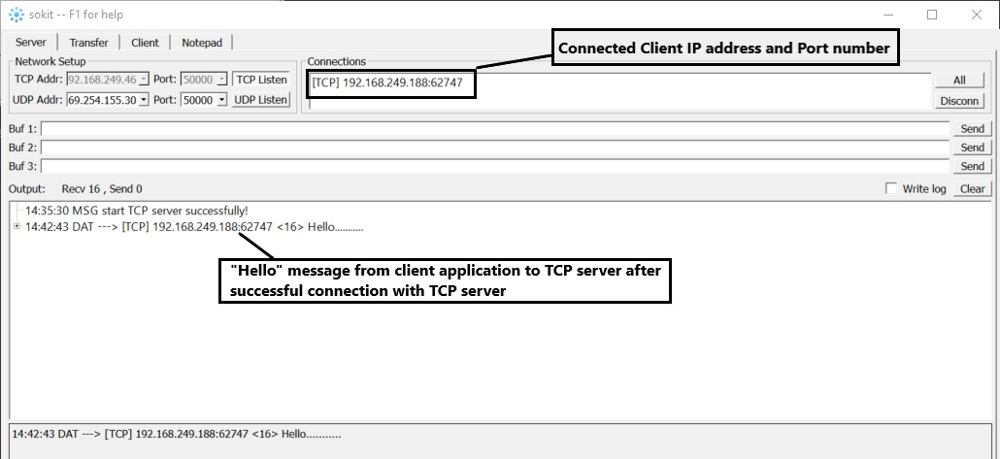

* After successful establishment of connection between TCP Client application (which is the EP running in client mode) and TCP server, message transfer can be made from server to client select the client in connections window, enter 'on' or 'off' in buffer section (shown as Buf1, Buf2, Buf3 in image) of sokit, as shown in below image.

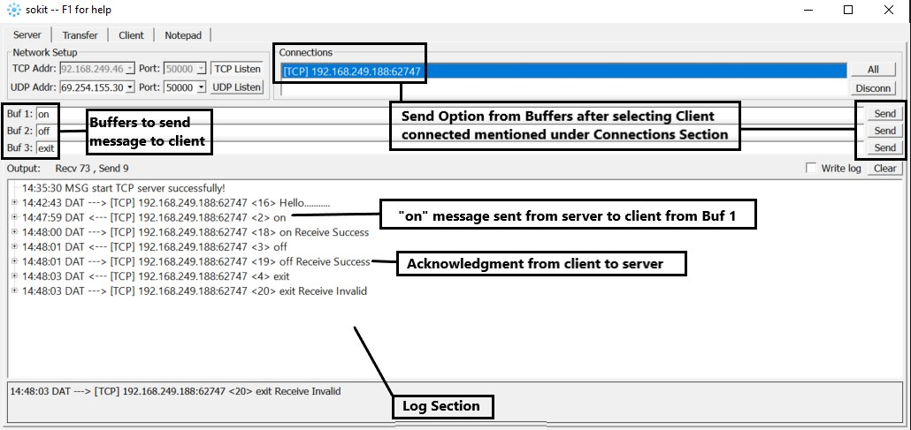

* For the application other message than "on" or "off" is considered invalid (Reception of message is shown in on terminal). Acknowledgement from connected client is sent to server on successful reception of "on" or "off" message. On sending "on", the user LED turns ON. On sending "off", the user LED turns OFF. No action is performed on reception of any other message string.

## Special Topics ##
### Running tips ###
* Presuming all necessary hardware connections done, users should connect their PC or laptop connected to the same Wi-Fi router AP. 
* On PC/laptop, the user needs to create TCP server and start listening at port which is free.
* TCP server on PC can be created using freely available tool sokit and using **[Steps for TCP server creation and connection](#steps_for_tcp_server_creation_and_connection)**.
* TCP server must be running before the application tries to connect otherwise TCP connection functionality will fail on running application. 
* Values sent from connected TCP server other than 'on' or 'off' will have no effect on LED.
* If the EP is not working in terms of network connection/IP, please re-check RA configuration property for pins and ensure that the TCP server is running before application starts.
